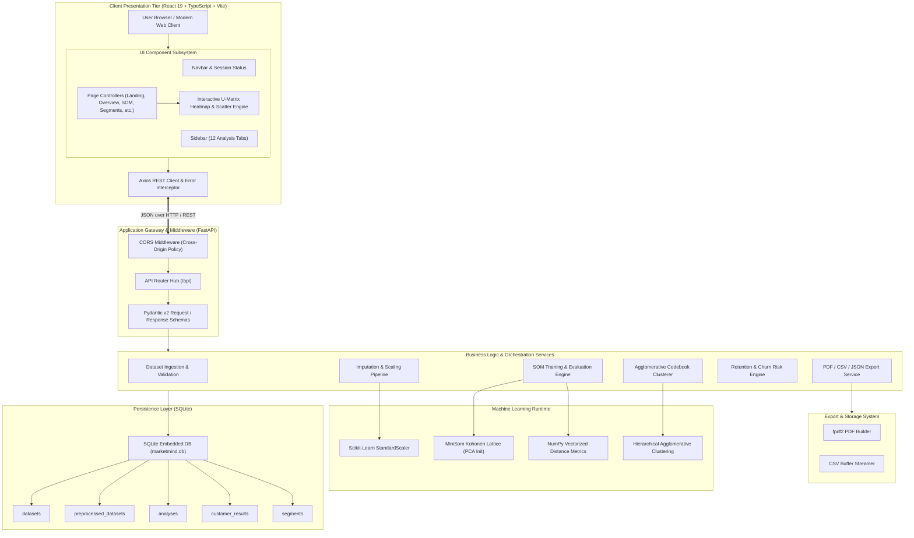
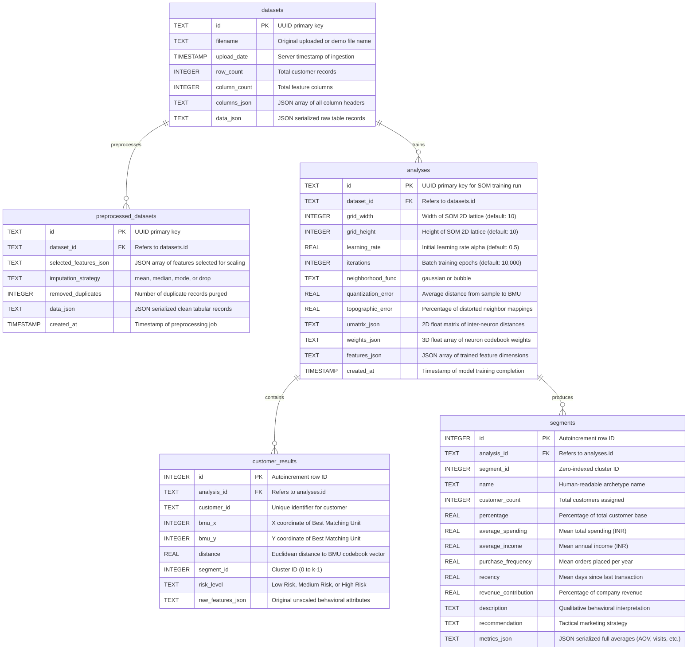

# System Architecture & Technical Design

This document details the architectural blueprint of **MarketMind**, including the system layers, machine learning pipeline, database schemas, component hierarchy, and communication contracts.

---

## 1. Architectural Principles & Patterns

The architecture is built upon the following design tenets:
- **Separation of Concerns**: UI rendering is strictly decoupled from statistical computing; FastAPI acts as an orchestration gateway between the React client and the scikit-learn/MiniSom ML engine.
- **Stateless Computation with Relational State**: ML training routines operate purely on in-memory vectorized matrices for maximum throughput, while results, weights, and metrics are persisted into an ACID-compliant relational store.
- **Topological Invariance**: High-dimensional consumer profiles are dimensionally reduced to a 2D neural lattice without losing non-linear feature relationships.
- **Reactive UI Flow**: The frontend maintains an asynchronous unidirectional data flow using React state hooks, enabling responsive transitions across 12 analytical views.

---

## 2. High-Level System Architecture



---

## 3. Machine Learning Pipeline Architecture

The machine learning workflow transforms raw, disparate behavioral features into structured archetypes through a multi-stage pipeline:

```mermaid
flowchart TD
    Raw[Raw Customer Dataset CSV / Excel] --> Inspect[Missing Value & Type Inspection]
    Inspect --> Impute[Imputation Strategy: Mean / Median / Mode / Drop]
    Impute --> Dedupe[Deduplication & Constant Column Filtering]
    Dedupe --> FeatSelect[Feature Subsetting: e.g. Spending, Income, Frequency, Recency]
    
    FeatSelect --> Scale["StandardScaler: z = (x - μ) / σ"]
    
    subgraph SOMTraining ["Self-Organizing Map (Kohonen Algorithm)"]
        Scale --> PCAInit[PCA Weight Initialization]
        PCAInit --> BatchTrain[MiniSom Batch Training: 10,000 Iterations]
        BatchTrain --> ComputeErrors[Calculate Quantization & Topographic Errors]
        BatchTrain --> UMat[Compute U-Matrix Distance Map]
        BatchTrain --> BMUCalc[Compute Best Matching Unit per Customer]
    end
    
    subgraph Clustering ["Post-SOM Hierarchical Clustering"]
        BatchTrain --> CodebookWeights[Extract Grid Codebook Weights (M x N x D)]
        CodebookWeights --> AggClust["Agglomerative Clustering (k Clusters)"]
        AggClust --> LatticeSegMatrix[2D Node-to-Segment Mapping Matrix]
        BMUCalc --> AssignSeg[Assign Customer to BMU's Cluster]
        LatticeSegMatrix --> AssignSeg
    end

    subgraph Profiling ["Behavioral Profiling & Strategy Generation"]
        AssignSeg --> AggStats[Compute Segment Centroids & Ratios]
        AggStats --> ArchetypeRule{Behavioral Rule Classifier}
        ArchetypeRule -->|Spend & Freq High| VIP[VIP High Spenders]
        ArchetypeRule -->|Freq High, Recency Low| Loyal[Loyal Steady Buyers]
        ArchetypeRule -->|Income High, Spend Low| Growth[Potential Growth Customers]
        ArchetypeRule -->|Discount Usage High| Bargain[Discount Sensitive Hunters]
        ArchetypeRule -->|Recency > 90 Days| AtRisk[At-Risk / Lapsing Customers]
        ArchetypeRule -->|Baseline| Occasional[Occasional Low Spenders]
        
        AssignSeg --> RiskScore[Rule-Based Churn Risk Index (0-100)]
        RiskScore --> RiskCategorize[Low / Medium / High Risk Tiers]
    end

    Profiling --> Persist[(Save to SQLite & Deliver via API)]
```

---

## 4. Database Entity Relationship (ER) Diagram

The SQLite database enforces referential integrity through foreign keys connecting datasets, preprocessing iterations, model analyses, and customer-level assignments.



---

## 5. Frontend Component Hierarchy & State Flow

The React frontend utilizes a single-page application structure organized into distinct logical zones:

```mermaid
graph TD
    App["App.tsx (Root Container & State Manager)"]
    
    App --> Nav["Navbar.tsx (Status Indicator, Demo Loader, Top Header)"]
    App --> Side["Sidebar.tsx (Collapsible Tab Selector with Icons)"]
    App --> Overlay["LoadingOverlay.tsx (Global Async Progress Shield)"]
    App --> MainZone["Active Page View Renderer"]
    
    MainZone --> P1["LandingPage.tsx (Hero Section, Key Features, Tech Highlights)"]
    MainZone --> P2["OverviewPage.tsx (Executive KPI Summary, High-Level Distribution)"]
    MainZone --> P3["DatasetPage.tsx (CSV/Excel Upload, Schema Validation, Data Preview)"]
    MainZone --> P4["PreprocessPage.tsx (Missing Data Analysis, Imputation Controls)"]
    MainZone --> P5["FeatureSelectPage.tsx (Feature Toggles, Correlation Heatmap)"]
    MainZone --> P6["SOMConfigPage.tsx (Grid Dimensions, Epochs, Learning Rate Sliders)"]
    MainZone --> P7["SOMAnalysisPage.tsx (U-Matrix Grid, Node Inspector, Customer Density)"]
    MainZone --> P8["SegmentsPage.tsx (Segment Cards, Reclustering Slider, Customer Table)"]
    MainZone --> P9["InsightsPage.tsx (Revenue Drivers, Churn Threats, Discount Reliance)"]
    MainZone --> P10["RecommendationsPage.tsx (Marketing Campaigns, Target Goals per Segment)"]
    MainZone --> P11["ReportsPage.tsx (Executive PDF Download, CSV & JSON Export)"]
    MainZone --> P12["EvaluationPage.tsx (Quantization & Topographic Error Analysis)"]
    
    P7 --> UMat["UMatrixGrid.tsx (Canvas/Cell Visualizer with Segment Overlay)"]
    P8 --> SegCard["SegmentCard.tsx (Badge, Metrics, Revenue Bar, Action Pill)"]
    P8 --> CustModal["CustomerModal.tsx (Individual Customer BMU Profile Modal)"]
    P8 --> Scatter["CustomerScatter.tsx (Income vs Spending Scatter Plot)"]
    P1 --> NetAnim["NetworkAnimation.tsx (Floating SOM Lattice Vector Animation)"]
```



### Shared Global State (`App.tsx`)
1. `activeDataset`: Holds dataset ID, column types, row counts, preview rows, and validation warnings.
2. `selectedFeatures`: Array of active feature column strings used for training.
3. `somConfig`: Current hyperparameters (`grid_width`, `grid_height`, `learning_rate`, `iterations`, `neighborhood_func`, `n_clusters`, `imputation_strategy`).
4. `activeAnalysis`: Complete training results, errors ($QE, TE$), U-Matrix matrix, and segment summaries.
5. `customers`: List of customer profiles enriched with BMU coordinates $(x, y)$, assigned segment, and risk tier.
6. `riskSummary`: Churn risk distribution counts and percentages.
7. `insights` & `recommendations`: Dynamically computed business playbooks.

---

## 6. Security, Scalability, and Reliability

### 1. Data Integrity & Input Validation
- All incoming payloads are validated using Pydantic models. Malformed types or missing fields trigger structured HTTP 422 responses.
- Safe SQL execution via parameterized SQLite queries prevents SQL injection.

### 2. High-Dimensional Computational Performance
- Vectorized operations using NumPy C-extensions ensure that calculating distances for 1,000+ customers over a $10 \times 10$ SOM finishes in under 2 seconds.
- PCA initialization ensures reproducible, faster training convergence than random initialization.

### 3. Client-Side Performance
- Recharts visualizations and U-Matrix canvas grids are rendered using virtualized React elements, preventing DOM slowdowns even with large customer populations.
- Vite build delivers tree-shaken, split JavaScript chunks for sub-second page loads.
