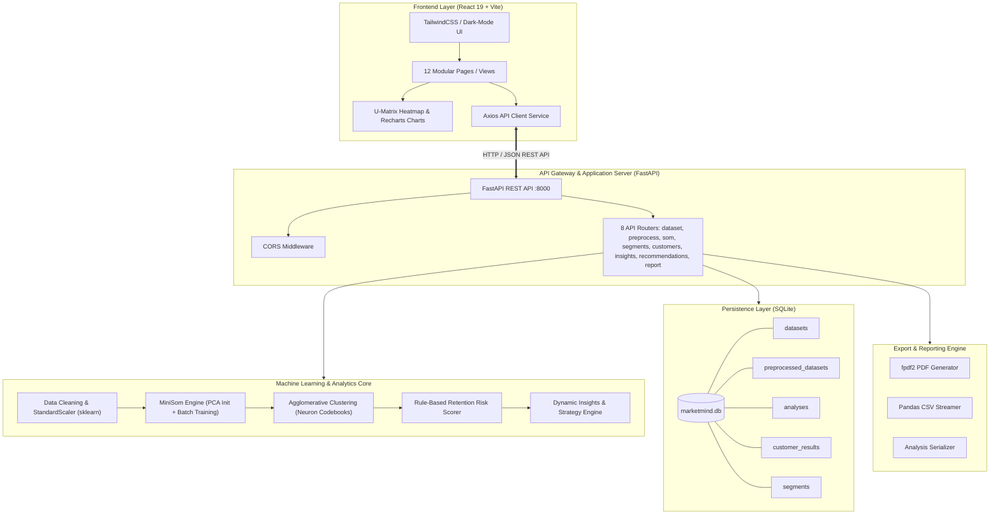
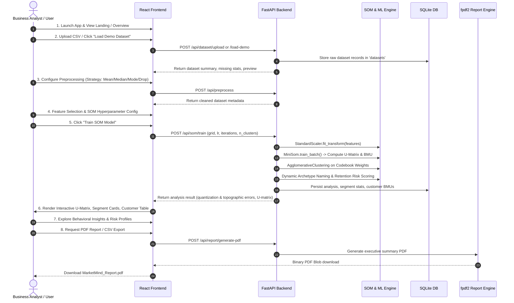
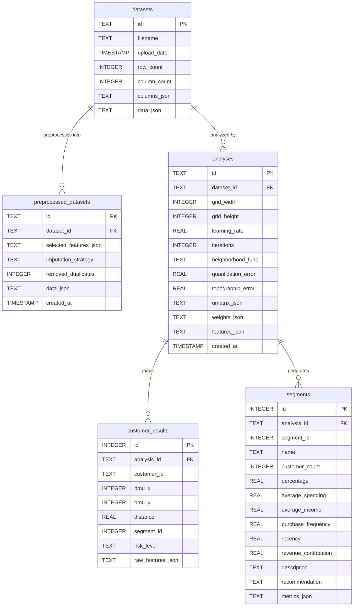

# MarketMind: Customer Behaviour Analysis Using Self-Organizing Maps (SOM)

MarketMind is an end-to-end machine learning analytics platform that applies unsupervised **Self-Organizing Maps (Kohonen SOM)** combined with **Hierarchical Agglomerative Clustering** to discover behavioral customer segments, compute retention risks, and deliver data-driven marketing strategies.

---

## 📑 Table of Contents

- [1. Executive Summary](#1-executive-summary)
- [2. System Architecture](#2-system-architecture)
- [3. Complete Tech Stack](#3-complete-tech-stack)
- [4. End-to-End Application Workflow](#4-end-to-end-application-workflow)
- [5. Machine Learning & SOM Mathematical Foundations](#5-machine-learning--som-mathematical-foundations)
- [6. Behavioral Segmentation & Risk Scoring](#6-behavioral-segmentation--risk-scoring)
- [7. Database Schema & Data Models](#7-database-schema--data-models)
- [8. REST API Reference Overview](#8-rest-api-reference-overview)
- [9. Project Structure](#9-project-structure)
- [10. Installation & Getting Started](#10-installation--getting-started)
- [11. Documentation Directory](#11-documentation-directory)

---

## 1. Executive Summary

Traditional customer segmentation often relies on basic RFM (Recency, Frequency, Monetary) thresholds or flat K-Means clustering, which can fail to capture high-dimensional non-linear interactions. 

**MarketMind** solves this by:
1. Projecting multi-dimensional customer behavioral profiles (income, spending score, purchase frequency, recency, order values, website visits, discount dependency) onto a **2D topological grid** using **Self-Organizing Maps**.
2. Computing the **Unified Distance Matrix (U-Matrix)** to visualize cluster boundaries and topological distances intuitively.
3. Grouping SOM codebook weight vectors using **Agglomerative Hierarchical Clustering** to classify customers into explainable behavioral archetypes:
   - 👑 **VIP High Spenders**
   - 🎯 **Loyal Steady Buyers**
   - ⚡ **Potential Growth Customers**
   - 🏷️ **Discount Sensitive Hunters**
   - ⚠️ **At-Risk / Lapsing Customers**
   - 📦 **Occasional Low Spenders**
4. Providing real-time **U-Matrix inspection**, **customer scatter distributions**, **retention risk scoring**, **automated executive PDF report generation**, and **targeted marketing playbooks**.

---

## 2. System Architecture

The application adopts a decoupled client-server architecture:
- **Presentation Layer**: React 19 + TypeScript + Vite Single Page Application (SPA) styled with TailwindCSS v4 and visual interactive charts via Recharts and custom canvas/SVG visualizers.
- **Application & API Layer**: FastAPI asynchronous REST API handling data validation, pipeline orchestration, and report streaming.
- **Machine Learning Core**: NumPy, Pandas, Scikit-learn, and MiniSom executing unsupervised neural topology mapping and hierarchical clustering.
- **Persistence Layer**: Embedded SQLite relational database storing datasets, model weight states, cluster memberships, and customer risk profiles.
- **Reporting Engine**: `fpdf2` creating print-ready executive summaries with tabular metrics and KPI breakdowns.

### High-Level Architecture Diagram



---

## 3. Complete Tech Stack

| Category | Technology | Version | Purpose |
| :--- | :--- | :--- | :--- |
| **Frontend Framework** | React | `^19.2.8` | Declarative reactive UI components |
| **Frontend Language** | TypeScript | `~6.0.2` | Strong static typing & interfaces |
| **Build & Dev Tool** | Vite | `^8.2.0` | Ultra-fast HMR and optimized production bundling |
| **Styling & Design** | TailwindCSS | `^4.3.3` | Utility-first responsive design, dark slate theme |
| **Icons** | Lucide React | `^1.33.0` | Modern SVG icons |
| **Data Visualization** | Recharts | `^3.10.1` | Bar charts, line charts, scatter plots, radar charts |
| **HTTP Client** | Axios | `^1.19.0` | Promise-based REST client with response interception |
| **Backend Framework** | FastAPI | `>=0.109.0` | High-performance Python async web framework |
| **ASGI Web Server** | Uvicorn | `>=0.27.0` | Lightning-fast ASGI HTTP server |
| **Data Validation** | Pydantic | `>=2.6.0` | Strict data schema parsing and request validation |
| **Self-Organizing Map** | MiniSom | `>=2.3.1` | Kohonen SOM implementation for 2D topological mapping |
| **Machine Learning** | Scikit-learn | `>=1.4.0` | Data scaling, imputation, Agglomerative Clustering |
| **Numerical Computing**| NumPy | `>=1.26.0` | Multi-dimensional array operations, distance metrics |
| **Scientific Computing**| SciPy | `>=1.12.0` | Statistical calculations & distance matrices |
| **Data Manipulation** | Pandas | `>=2.1.0` | Tabular data manipulation, aggregation, correlation |
| **Spreadsheet Engine** | openpyxl | `>=3.1.2` | Excel file parsing and ingestion |
| **Database** | SQLite3 | Native | Embedded zero-config relational database |
| **PDF Generation** | fpdf2 | `>=2.7.8` | Programmatic executive PDF reporting |

---

## 4. End-to-End Application Workflow



### Detailed Workflow Stages

1. **Dataset Ingestion**:
   - Accepts CSV or Excel formats (`.csv`, `.xlsx`, `.xls`).
   - Automatically inspects schema, counts null values, identifies numeric vs categorical columns, and detects constant or zero-variance columns.
   - Built-in one-click demo dataset generator synthesizing 1,000 customers across 6 behavioral archetypes.

2. **Data Cleaning & Standardization**:
   - Offers customizable missing-value imputation (`mean`, `median`, `mode`, or `drop`).
   - Scales numeric variables using `StandardScaler` ($z = \frac{x - \mu}{\sigma}$) to prevent high-magnitude features (such as annual income) from dominating distance calculations.

3. **Feature Selection**:
   - Dynamic interactive checkboxes allow toggling behavioral metrics (e.g., `Age`, `Annual_Income`, `Spending_Score`, `Purchase_Frequency`, `Total_Spending`, `Average_Order_Value`, `Recency`, `Website_Visits`, `Discount_Usage`, `Customer_Lifetime_Value`).
   - Real-time Pearson Correlation Matrix preview to diagnose multicollinearity.

4. **SOM Hyperparameter Configuration**:
   - **Grid Dimensions ($M \times N$)**: Typically $10 \times 10$ (100 neurons).
   - **Learning Rate ($\alpha$)**: Starting rate (e.g., $0.5$) with decaying decay schedule.
   - **Neighborhood Function**: Gaussian or Bubble kernel.
   - **Iterations**: 5,000 – 20,000 epochs.
   - **Target Clusters ($k$)**: Number of macro behavioral segments (default: 6).

5. **SOM Training & Topological Projection**:
   - Weight vectors initialized via **Principal Component Analysis (PCA)** for rapid, deterministic convergence.
   - Batch training aligns neurons with high-density regions of the input manifold.
   - Quantization Error ($QE$) and Topographic Error ($TE$) calculated to benchmark map fidelity.

6. **U-Matrix & Node Density Inspection**:
   - Generates the **Unified Distance Matrix (U-Matrix)** displaying Euclidean distances between adjacent neuron weight vectors.
   - High values (ridges) denote natural cluster boundaries; low values (valleys) represent cluster centers.
   - Interactive cell hover shows neuron coordinates $(x, y)$, assigned segment, and customer sample counts.

7. **Hierarchical Agglomerative Clustering**:
   - SOM codebook vectors $(W \in \mathbb{R}^{M \times N \times D})$ are clustered into $k$ discrete groups.
   - Each customer sample is assigned to the cluster of its **Best Matching Unit (BMU)**.
   - Segments are automatically labeled with business archetypes based on relative spending, recency, and frequency ratios.

8. **Behavioral Churn & Retention Risk Profiling**:
   - Evaluates purchase recency, transaction frequency, site activity, and discount reliance.
   - Calculates a risk score from $0$ to $100$ and stratifies customers into **Low Risk**, **Medium Risk**, and **High Risk**.

9. **Actionable Marketing Playbooks**:
   - Generates targeted campaign recommendations for each segment (e.g., "Black Diamond Member Exclusives", "Always-On Loyalty Advantage", "Smart Saver Bundles", "We Miss You Win-Back").

10. **Reports & Exports**:
    - **PDF Executive Report**: Includes dataset overview, SOM topology metrics, segment breakdown tables, and key insights.
    - **CSV Export**: Full customer dataset enriched with BMU coordinates, distance to codebook vector, segment assignment, and churn risk level.
    - **JSON Export**: Complete raw analysis dump for downstream ML pipelines or BI dashboards.

---

## 5. Machine Learning & SOM Mathematical Foundations

### 5.1 Best Matching Unit (BMU)

For an input vector $\mathbf{x} \in \mathbb{R}^D$, the BMU $c$ is the neuron whose codebook weight vector $\mathbf{w}_c$ has the minimum Euclidean distance to $\mathbf{x}$:

$$c = \arg\min_i \|\mathbf{x} - \mathbf{w}_i\| = \arg\min_i \sqrt{\sum_{j=1}^D (x_j - w_{ij})^2}$$

### 5.2 Neighborhood Function & Weight Update

During training, the weights of the BMU and its topological neighbors on the 2D lattice are updated towards the input sample:

$$\mathbf{w}_i(t+1) = \mathbf{w}_i(t) + \alpha(t) \cdot h_{ci}(t) \cdot (\mathbf{x} - \mathbf{w}_i(t))$$

Where:
- $\alpha(t) = \alpha_0 \cdot \left(1 - \frac{t}{T}\right)$ is the decaying learning rate over iteration $t$ of total iterations $T$.
- $h_{ci}(t) = \exp\left(-\frac{\|\mathbf{r}_c - \mathbf{r}_i\|^2}{2\sigma^2(t)}\right)$ is the Gaussian neighborhood kernel.
- $\sigma(t) = \sigma_0 \cdot \left(1 - \frac{t}{T}\right)$ is the shrinking neighborhood radius.

### 5.3 Unified Distance Matrix (U-Matrix)

For any neuron $(i, j)$ on the lattice, its U-Matrix value $U_{ij}$ represents the mean Euclidean distance to its immediate 4-connected (or 8-connected) neighboring neurons:

$$U_{ij} = \frac{1}{|N(i,j)|} \sum_{(k,l) \in N(i,j)} \|\mathbf{w}_{ij} - \mathbf{w}_{kl}\|$$

### 5.4 SOM Evaluation Metrics

- **Quantization Error ($QE$)**: Measures the average Euclidean distance between each data sample and its BMU weight vector. Lower values indicate better data fit:
  $$QE = \frac{1}{N} \sum_{k=1}^N \|\mathbf{x}_k - \mathbf{w}_{c(\mathbf{x}_k)}\|$$

- **Topographic Error ($TE$)**: Measures the proportion of data samples for which the 1st BMU and 2nd BMU are not topological neighbors on the grid. Lower values denote preservation of manifold topology:
  $$TE = \frac{1}{N} \sum_{k=1}^N u(\mathbf{x}_k), \quad u(\mathbf{x}_k) = \begin{cases} 0 & \text{if 1st and 2nd BMU are adjacent} \\ 1 & \text{otherwise} \end{cases}$$

---

## 6. Behavioral Segmentation & Risk Scoring

### Segment Dynamic Classification Rules

The system calculates global dataset averages ($\mu_{\text{income}}, \mu_{\text{spend}}, \mu_{\text{freq}}, \mu_{\text{recency}}, \mu_{\text{disc}}$) and compares each cluster's mean against them:

| Archetype Name | Badge | Classification Condition | Marketing Action |
| :--- | :---: | :--- | :--- |
| **VIP High Spenders** | 👑 VIP | Spend Ratio $\ge 1.25$ & Freq Ratio $\ge 1.2$ | Concierge support, VIP exclusive rewards, early access |
| **Loyal Steady Buyers** | 🎯 Loyal | Freq Ratio $\ge 1.15$ & Recency Ratio $\le 0.8$ | Replenishment subscriptions, loyalty multiplier days |
| **Potential Growth** | ⚡ Growth | Income Ratio $\ge 1.1$ & Spend Ratio $< 1.0$ | Premium upselling, personalized catalog recommendations |
| **Discount Hunters** | 🏷️ Bargain | Discount Usage Ratio $\ge 1.25$ | Minimum spend thresholds (e.g. ₹3,000 for ₹500 off) |
| **At-Risk / Lapsing** | ⚠️ At-Risk | Recency Ratio $\ge 1.4$ (or Recency $> 90$ days) | Multi-touch win-back campaign, re-activation vouchers |
| **Occasional Low** | 📦 Occasional | Baseline / Fallback | Low-friction introductory offers, educational content |

### Churn Risk Score Formula

For each customer, a heuristic risk index $R \in [0, 100]$ is computed:
- **Recency Component**: $+40$ if $>120$ days, $+25$ if $>60$ days, $+10$ if $>30$ days.
- **Frequency Component**: $+30$ if $\le 2$ orders, $+15$ if $\le 5$ orders, $+5$ if $\le 10$ orders.
- **Engagement Component**: $+15$ if website visits $< 10$, $+5$ if $< 20$.
- **Margin Risk**: $+15$ if discount usage $> 60\%$ with total spending $< ₹50,000$.

Stratification:
- **Low Risk**: $R < 30$
- **Medium Risk**: $30 \le R < 60$
- **High Risk**: $R \ge 60$

---

## 7. Database Schema & Data Models

SQLite database (`backend/marketmind.db`) uses the following schema:



---

## 8. REST API Reference Overview

| Router Prefix | Method | Endpoint | Description |
| :--- | :--- | :--- | :--- |
| `/api/dataset` | `POST` | `/load-demo` | Generates & loads 1,000 synthetic behavioral customer records |
| `/api/dataset` | `POST` | `/upload` | Uploads CSV or Excel dataset file |
| `/api/dataset` | `GET` | `/{dataset_id}` | Retrieves dataset summary, validation, and sample rows |
| `/api/preprocess` | `POST` | `/` | Applies missing value imputation & cleans duplicate rows |
| `/api/som` | `POST` | `/train` | Runs MiniSom training, U-matrix generation, & clustering |
| `/api/som` | `GET` | `/{analysis_id}` | Returns complete analysis metrics, parameters, and segments |
| `/api/som` | `GET` | `/{analysis_id}/umatrix` | Returns 2D grid matrix of U-Matrix distance values |
| `/api/segments` | `GET` | `/{analysis_id}` | Fetches detailed segment profiles and financial statistics |
| `/api/segments` | `POST` | `/{analysis_id}/recluster` | Re-clusters SOM codebooks with updated cluster count $k$ |
| `/api/customers` | `GET` | `/{analysis_id}` | Paginated customer listing filtered by segment or risk |
| `/api/customers` | `GET` | `/detail/{customer_id}` | Fetches individual customer profile and BMU mapping |
| `/api/insights` | `GET` | `/{analysis_id}` | Returns correlation matrix, top revenue drivers, & churn risks |
| `/api/recommendations` | `GET` | `/{analysis_id}` | Returns tailored marketing campaigns per segment |
| `/api/report` | `POST` | `/generate-pdf` | Generates and streams structured PDF report |
| `/api/report` | `GET` | `/export-csv/{analysis_id}` | Downloads segmented customer CSV file |
| `/api/report` | `GET` | `/export-json/{analysis_id}` | Downloads complete JSON dump of analysis |

*For complete request bodies and response schemas, see [API_REFERENCE.md](API_REFERENCE.md).*

---

## 9. Project Structure

```
Market Customer Behaviour Analysis using SOM/
├── backend/
│   ├── app/
│   │   ├── api/                     # FastAPI Route Controllers
│   │   │   ├── customers.py         # Customer query & detail endpoints
│   │   │   ├── dataset.py           # Upload, demo loading & preview
│   │   │   ├── insights.py          # Market insights & correlation
│   │   │   ├── preprocess.py        # Imputation & deduplication
│   │   │   ├── recommendations.py   # Business recommendation logic
│   │   │   ├── report.py            # PDF, CSV, JSON export routes
│   │   │   ├── segments.py          # Segment metrics & reclustering
│   │   │   └── som.py               # MiniSom training orchestrator
│   │   ├── database/
│   │   │   └── connection.py        # SQLite schema & connection helpers
│   │   ├── ml/                      # Machine Learning Core
│   │   │   ├── insights.py          # Risk scoring & dynamic insights
│   │   │   ├── preprocessing.py     # StandardScaler & data transformation
│   │   │   ├── segmentation.py      # Agglomerative clustering & archetypes
│   │   │   └── som_engine.py        # MiniSom runner & metric calculations
│   │   ├── services/
│   │   │   └── report_service.py    # fpdf2 PDF report builder
│   │   └── main.py                  # FastAPI application entry point
│   ├── marketmind.db                # SQLite database file
│   └── requirements.txt             # Python backend dependencies
│
├── frontend/
│   ├── public/                      # Static assets & favicon
│   ├── src/
│   │   ├── components/              # Modular UI Components
│   │   │   ├── CustomerModal.tsx    # Customer drilldown modal
│   │   │   ├── CustomerScatter.tsx  # Interactive scatter plot
│   │   │   ├── LoadingOverlay.tsx   # Loading spinner overlay
│   │   │   ├── Navbar.tsx           # Global top navigation bar
│   │   │   ├── NetworkAnimation.tsx # Neural net visual graphic
│   │   │   ├── SegmentCard.tsx      # Behavioral segment metric card
│   │   │   ├── Sidebar.tsx          # Collapsible navigation sidebar
│   │   │   └── UMatrixGrid.tsx      # Heatmap grid visualizer
│   │   ├── pages/                   # Application Views
│   │   │   ├── DatasetPage.tsx      # File upload & data preview
│   │   │   ├── EvaluationPage.tsx   # Model quantization & topo errors
│   │   │   ├── FeatureSelectPage.tsx# Feature toggles & correlation
│   │   │   ├── InsightsPage.tsx     # Behavioral trends & risk cards
│   │   │   ├── LandingPage.tsx      # Welcome hero page
│   │   │   ├── OverviewPage.tsx     # High-level KPIs & executive summary
│   │   │   ├── PreprocessPage.tsx   # Missing value cleaning
│   │   │   ├── RecommendationsPage.tsx # Segment marketing strategies
│   │   │   ├── ReportsPage.tsx      # PDF, CSV, JSON export hub
│   │   │   ├── SegmentsPage.tsx     # Segment comparisons & tables
│   │   │   ├── SOMAnalysisPage.tsx  # U-Matrix visualizer & BMU explorer
│   │   │   └── SOMConfigPage.tsx    # Grid, epochs & learning rate inputs
│   │   ├── services/
│   │   │   └── api.ts               # Axios API client functions
│   │   ├── types/
│   │   │   └── index.ts             # TypeScript interfaces & models
│   │   ├── App.tsx                  # Main root state orchestrator
│   │   ├── index.css                # TailwindCSS tokens & base styles
│   │   └── main.tsx                 # React DOM mount point
│   ├── package.json                 # Frontend dependencies & scripts
│   ├── tsconfig.json                # TypeScript compiler config
│   └── vite.config.ts               # Vite configuration & proxy settings
│
├── data/
│   ├── generate_dataset.py          # Synthetic customer data generator script
│   └── sample_customers.csv         # Generated sample customer dataset
│
├── readme/                          # Comprehensive Documentation Folder
│   ├── README.md                    # Primary master documentation (this file)
│   ├── ARCHITECTURE.md              # In-depth architectural designs & diagrams
│   ├── TECH_STACK.md                # Detailed technology stack breakdown
│   ├── WORKFLOW.md                  # Step-by-step user and pipeline workflow
│   └── API_REFERENCE.md             # Complete REST API endpoint reference
│
└── README.md                        # Root quick-start guide & navigation index
```

---

## 10. Installation & Getting Started

### Prerequisites
- **Python 3.10+**
- **Node.js 18+ & npm**
- **Git**

### Backend Setup

```bash
# 1. Navigate to backend directory
cd backend

# 2. Create virtual environment
python -m venv venv

# 3. Activate virtual environment
# Windows:
venv\Scripts\activate
# Linux/macOS:
source venv/bin/activate

# 4. Install dependencies
pip install -r requirements.txt

# 5. Initialize the database & launch server
python -m app.main
```
The FastAPI server will start at `http://localhost:8000`. Interactive OpenAPI documentation will be accessible at `http://localhost:8000/docs`.

### Frontend Setup

```bash
# 1. Open a new terminal and navigate to frontend directory
cd frontend

# 2. Install NPM packages
npm install

# 3. Launch Vite development server
npm run dev
```
The React application will be accessible at `http://localhost:5173`. Vite is preconfigured to proxy `/api` calls to `http://localhost:8000`.

---

## 11. Documentation Directory

For in-depth explanations of specific subsystems, consult the corresponding guides inside this `readme/` folder:

- 🏗️ **[ARCHITECTURE.md](ARCHITECTURE.md)**: System design, entity relationships, data flowcharts, and component hierarchy.
- 💻 **[TECH_STACK.md](TECH_STACK.md)**: Detailed breakdown of frameworks, libraries, versions, and selection rationale.
- 🔄 **[WORKFLOW.md](WORKFLOW.md)**: Step-by-step operational workflow from raw data ingestion to PDF generation.
- 📡 **[API_REFERENCE.md](API_REFERENCE.md)**: Full REST API specification with endpoints, request payloads, and response structures.
