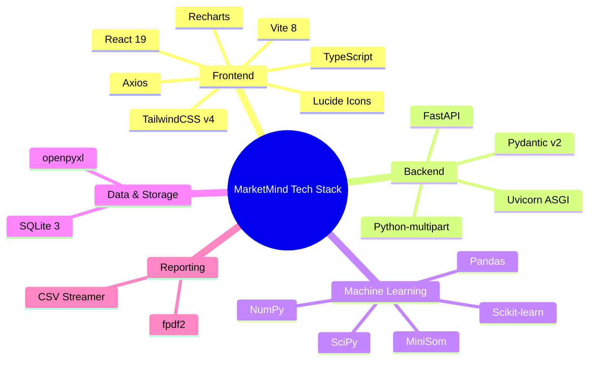

# Technology Stack & Dependency Architecture

This document provides a comprehensive analysis of all technologies, libraries, tools, and runtime environments powering the **MarketMind** analytics platform.

---

## 1. Technology Matrix Overview



---

## 2. Frontend Technology Stack

### 2.1 Core Framework & Language

| Package | Version | Selection Rationale |
| :--- | :--- | :--- |
| **React** | `^19.2.8` | Component-based, highly reactive architecture optimal for dashboard interfaces with high-frequency state updates (hyperparameter sliders, node hover, real-time reclustering). |
| **TypeScript** | `~6.0.2` | Enforces compile-time type safety across complex data models (customer profiles, SOM configurations, segment metrics), reducing runtime crashes. |
| **Vite** | `^8.2.0` | Ultra-fast native ES modules (ESM) hot module replacement (HMR), lightweight bundle size, and effortless API proxy configuration. |

### 2.2 Styling & Presentation

| Package | Version | Selection Rationale |
| :--- | :--- | :--- |
| **TailwindCSS** | `^4.3.3` | Utility-first CSS framework providing a cohesive modern dark-mode aesthetic (`slate-900`, `indigo-500`, `emerald-500`). Zero runtime overhead. |
| **@tailwindcss/vite** | `^4.3.3` | Official Vite integration plugin delivering instantaneous stylesheet compilation. |
| **clsx** & **tailwind-merge** | `^2.1.1` & `^3.6.0` | Allows conditional class composition without style collision or redundant specificity conflicts. |

### 2.3 Data Visualization & Graphics

| Package | Version | Selection Rationale |
| :--- | :--- | :--- |
| **Recharts** | `^3.10.1` | Declarative SVG-based charting library tailored for React. Powers the customer scatter distributions, segment revenue bar charts, and metric radar diagrams. |
| **Lucide React** | `^1.33.0` | Clean, crisp, feather-weight icon set providing intuitive navigation indicators across 12 analytical tabs. |

### 2.4 Communication & Networking

| Package | Version | Selection Rationale |
| :--- | :--- | :--- |
| **Axios** | `^1.19.0` | Feature-rich HTTP client with automatic JSON deserialization, binary blob handling (for PDF report download), and robust error catching. |

---

## 3. Backend Technology Stack

### 3.1 Web Framework & Server

| Package | Version | Selection Rationale |
| :--- | :--- | :--- |
| **FastAPI** | `>=0.109.0` | Modern, asynchronous Python web framework built on Starlette and Pydantic. Delivers native concurrency, automatic OpenAPI (Swagger) documentation, and type-safe request parsing. Chosen over Flask/Django for superior async I/O performance and minimal boilerplate. |
| **Uvicorn** | `>=0.27.0` | High-performance ASGI (Asynchronous Server Gateway Interface) web server implementation for Python. |
| **Pydantic** | `>=2.6.0` | High-speed Rust-backed data validation and serialization engine, ensuring incoming SOM configurations and filtering parameters strictly adhere to expected types. |
| **python-multipart**| `>=0.0.9` | Required by FastAPI to handle streaming `multipart/form-data` uploads when users ingest custom CSV or Excel files. |

---

## 4. Machine Learning & Scientific Computing Stack

| Package | Version | Role & Selection Rationale |
| :--- | :--- | :--- |
| **MiniSom** | `>=2.3.1` | Minimalistic, highly efficient NumPy-based implementation of Kohonen's Self-Organizing Maps. Provides PCA weight initialization, Gaussian neighborhood decay, batch training, U-Matrix distance computation, and topographic error metrics. |
| **scikit-learn** | `>=1.4.0` | Industry-standard ML toolkit. Powers: <br>1. `StandardScaler` for zero-mean unit-variance feature normalization.<br>2. `AgglomerativeClustering` for grouping SOM codebook weight vectors into macro behavioral clusters. |
| **NumPy** | `>=1.26.0` | Underpins all vectorized linear algebra, matrix distance computations (Euclidean norms), and multidimensional grid reshaping. |
| **SciPy** | `>=1.12.0` | Provides advanced scientific computing routines for spatial distance calculations, correlation matrices, and statistical distributions. |
| **Pandas** | `>=2.1.0` | High-performance tabular data structures (`DataFrame`) utilized for dataset loading, deduplication, missing-value imputation, aggregation, and correlation extraction. |

---

## 5. Storage, Data Ingestion & Export Stack

| Package | Version | Selection Rationale |
| :--- | :--- | :--- |
| **SQLite3** | Native (Python standard) | Serverless, zero-configuration, ACID-compliant relational storage. Eliminates the complexity of hosting external database containers while providing robust multi-table relational persistence for datasets, model analyses, and customer cluster mappings. |
| **openpyxl** | `>=3.1.2` | Enables seamless parsing and ingestion of modern Microsoft Excel spreadsheets (`.xlsx`). |
| **fpdf2** | `>=2.7.8` | Lightweight, fast Python PDF generation engine. Chosen over bulky engines (like ReportLab or headless browser printing) because it compiles clean, deterministic, multi-page business summaries with low memory consumption. |

---

## 6. Build, Linting & Configuration Tools

- **Node.js**: Recommended `v18.x` or `v20.x` LTS.
- **Python**: Recommended `3.10+` or `3.11+`.
- **Oxlint (`^1.75.0`)**: High-speed linter built in Rust, replacing ESLint for 50x-100x faster static analysis and code cleanliness in the frontend.
- **Vite Configuration (`vite.config.ts`)**:
  ```typescript
  import { defineConfig } from 'vite';
  import react from '@vitejs/plugin-react';
  import tailwindcss from '@tailwindcss/vite';

  export default defineConfig({
    plugins: [react(), tailwindcss()],
    server: {
      proxy: {
        '/api': {
          target: 'http://localhost:8000',
          changeOrigin: true
        }
      }
    }
  });
  ```
- **Backend Application Entry (`backend/app/main.py`)**:
  ```python
  app = FastAPI(
      title="MarketMind - Customer Behaviour Analysis API",
      description="Backend API powering SOM-based customer segmentation, U-Matrix visualization, and AI recommendations.",
      version="1.0.0"
  )
  ```
