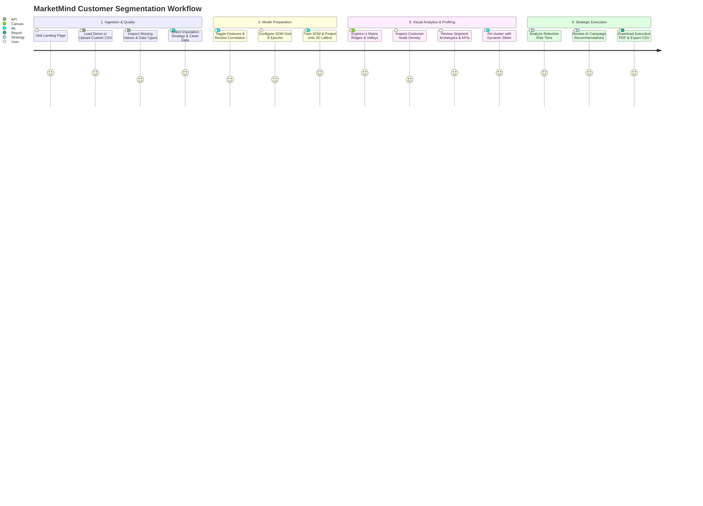

# End-to-End Application Workflow

This document provides a detailed walkthrough of the complete operational and analytical journey within **MarketMind**, from data ingestion to model training, cluster interpretation, and automated business report generation.

---

## 1. High-Level User Journey



---

## 2. Step-by-Step Workflow by Stage

### Phase 1: Ingestion & Data Quality Assessment

#### Tab 1: Landing Page (`LandingPage.tsx`)
- Introduces the platform, key capabilities, and underlying algorithms.
- Provides immediate call-to-action buttons:
  - **"Load Demo Dataset"**: Instantly provisions a 1,000-customer synthetic dataset pre-configured with 6 realistic market archetypes.
  - **"Upload Your Data"**: Directs the user to the custom file ingestion pipeline.
- Features an animated neural lattice canvas graphic representing topological self-organization.

#### Tab 2: Executive Overview Dashboard (`OverviewPage.tsx`)
- Displays top-level business health KPIs:
  - Total Analyzed Customers
  - Identified Behavioral Clusters
  - Average Customer Lifetime Value (CLV)
  - Top Performing Revenue Segment
- Provides a quick visual summary of spending distributions and segment proportions before deep diving.

#### Tab 3: Dataset Upload & Inspection (`DatasetPage.tsx`)
- Drag-and-drop file upload supporting `.csv`, `.xlsx`, and `.xls` files.
- Automated parsing generates an instant **Data Health Report**:
  - Total rows and columns.
  - Total missing cells and overall missing percentage.
  - Number of duplicate rows detected.
  - Identification of numeric vs. categorical columns.
  - Warning badges for constant/zero-variance features.
- Interactive data table showing the first 10 sample records.

---

### Phase 2: Cleaning, Transformation & Feature Engineering

#### Tab 4: Data Preprocessing (`PreprocessPage.tsx`)
- Allows the user to select a missing-value resolution strategy:
  1. **Mean Imputation**: Replaces missing numeric values with the column arithmetic mean (best for normally distributed metrics).
  2. **Median Imputation**: Replaces missing values with the 50th percentile (recommended when outliers or extreme spending spikes exist).
  3. **Mode Imputation**: Replaces missing values with the most frequent category.
  4. **Drop Records**: Purges any row with at least one missing entry.
- Automatically strips duplicate records.
- Transforms data into clean in-memory representations and generates an audit log of cleaned rows.

#### Tab 5: Feature Selection (`FeatureSelectPage.tsx`)
- Interactive toggle grid allowing analysts to select which attributes participate in SOM topological projection:
  - `Age`
  - `Annual_Income`
  - `Spending_Score`
  - `Purchase_Frequency`
  - `Total_Spending`
  - `Average_Order_Value`
  - `Recency`
  - `Website_Visits`
  - `Discount_Usage`
  - `Customer_Lifetime_Value`
- **Pearson Correlation Heatmap**:
  - Dynamically calculates the correlation matrix across selected features.
  - Helps the user spot multicollinearity (e.g., high correlation between `Total_Spending` and `Purchase_Frequency`).

---

### Phase 3: Neural Model Configuration & Training

#### Tab 6: SOM Configuration (`SOMConfigPage.tsx`)
Analysts configure the unsupervised neural network hyperparameters:
- **Grid Width & Height** (Default: $10 \times 10 = 100$ neurons): Controls the resolution of the topological lattice.
- **Learning Rate ($\alpha$)** (Default: $0.5$): Initial step size for codebook weight updates.
- **Iterations** (Default: $10,000$ epochs): Number of batch training steps.
- **Neighborhood Function**:
  - `gaussian`: Smooth bell-curve influence decay across adjacent neurons.
  - `bubble`: Constant step-function influence within radius $\sigma$.
- **Target Segments ($k$)** (Default: $6$): Number of agglomerative clusters to partition codebook weight vectors into.

#### Training Execution
Upon clicking **"Train SOM Model"**, the backend executes:
1. `StandardScaler.fit_transform()` on selected features.
2. `som.pca_weights_init()` for deterministic, rapid convergence.
3. `som.train_batch()` across the specified iteration budget.
4. Calculation of **Quantization Error ($QE$)** and **Topographic Error ($TE$)**.
5. Generation of the **Unified Distance Matrix (U-Matrix)**.
6. Agglomerative clustering of the $100$ codebook vectors into $k$ segments.
7. Mapping every customer to their Best Matching Unit (BMU) coordinates $(x, y)$.

---

### Phase 4: Topological Visualization & Customer Segmentation

#### Tab 7: SOM Visualizer (U-Matrix) (`SOMAnalysisPage.tsx`)
- Displays an interactive $10 \times 10$ **U-Matrix Heatmap** (`UMatrixGrid.tsx`):
  - **Color Gradient**: Dark/low values indicate dense clusters; bright/high values represent topological boundaries (ridges) separating distinct behavioral patterns.
  - **Segment Overlay**: Neurons are color-coded by their assigned Agglomerative Cluster.
  - **Customer Density View**: Toggles cell values to display the exact number of customers mapped to each neuron.
- **Neuron Hover Inspector**: Hovering over any cell reveals its $(x, y)$ coordinates, distance score, segment archetype, and member count.

#### Tab 8: Customer Segments (`SegmentsPage.tsx`)
- **Segment Cards (`SegmentCard.tsx`)**:
  - Archetype badge (👑 VIP, 🎯 Loyal, ⚡ Growth, 🏷️ Bargain, ⚠️ At-Risk, 📦 Occasional).
  - Customer count and percentage share.
  - Average Income, Average Total Spending, Purchase Frequency, and Recency.
  - Revenue Contribution percentage bar.
- **Dynamic Re-Clustering Slider**:
  - Allows instantaneous re-grouping of the trained SOM into $3$ to $10$ clusters without re-running the 10,000-epoch SOM training loop.
- **Customer Scatter Distribution (`CustomerScatter.tsx`)**:
  - 2D scatter plot (Annual Income vs. Total Spending) color-coded by segment.
- **Customer Directory Table**:
  - Searchable, filterable list of customers showing their BMU coordinates, distance metric, segment, and risk tier.
  - Clicking any row opens the **Customer Profile Modal (`CustomerModal.tsx`)** showing detailed RFM indicators.

---

### Phase 5: Business Intelligence, Strategy & Reporting

#### Tab 9: Behaviour Insights (`InsightsPage.tsx`)
- **Primary Revenue Driver**: Highlights which segment produces the highest percentage of gross sales.
- **Revenue Loss Threat**: Pinpoints at-risk customers, quantifying the exact dollar value at risk of churn.
- **Discount Dependency**: Identifies margin-diluting discount behavior.
- **Retention Risk Cards**: Visual breakdown of **Low Risk**, **Medium Risk**, and **High Risk** cohorts with targeted intervention recommendations.

#### Tab 10: AI Recommendations (`RecommendationsPage.tsx`)
Delivers actionable marketing playbooks tailored to each archetype:
- **VIP High Spenders**: Concierge support, early product drops, exclusive VIP club.
- **Loyal Steady Buyers**: Replenishment reminders, loyalty points multipliers.
- **Potential Growth**: Upselling campaigns, category discovery, personalized bundling.
- **Discount Hunters**: Minimum spend thresholds (e.g. ₹3,000 for ₹500 discount).
- **At-Risk / Lapsing**: Automated 3-stage win-back email/SMS sequences.
- **Occasional Buyers**: Low-friction starter discounts, education newsletters.

#### Tab 11: Reports & Export Hub (`ReportsPage.tsx`)
- **Download PDF Report**:
  - Generates a styled, print-ready executive summary using `fpdf2`.
  - Includes dataset metadata, SOM grid parameters, model error benchmarks, segment comparison tables, and tactical recommendations.
- **Export Enriched CSV**:
  - Downloads the complete customer database enriched with BMU coordinates (`bmu_x`, `bmu_y`), Euclidean distance, assigned `Segment_ID`, archetype name, and `risk_level`.
- **Export Full JSON**:
  - Dumps the complete analysis structure (including U-Matrix grid, codebook weights, and segment centroids) for external ML pipelines or BI tools.

#### Tab 12: Model Evaluation (`EvaluationPage.tsx`)
- Deep dive into map topology health:
  - **Quantization Error ($QE$)**: Average distance from input vectors to their BMUs.
  - **Topographic Error ($TE$)**: Metric assessing how well neighborhood relations are preserved.
  - **Interpretation Guide**: Explains how to adjust grid size and learning rates if errors indicate underfitting or topological folding.

---

## 3. Synthetic Customer Archetypes Reference

When loading the demo dataset (`data/generate_dataset.py`), the generator synthesizes 1,000 records based on 6 behavioral archetypes:

```
┌───────────────────────────┬────────┬──────────────┬──────────────┬──────────────┬──────────────┐
│ Archetype                 │ Weight │ Income Range │ Spend Score  │ Freq (yr)    │ Recency (d)  │
├───────────────────────────┼────────┼──────────────┼──────────────┼──────────────┼──────────────┤
│ 1. VIP High Spenders      │  15%   │ 12L - 28L    │ 80 - 99      │ 15 - 30      │ 1 - 15       │
│ 2. Loyal Steady Buyers    │  25%   │  6L - 14L    │ 60 - 85      │ 10 - 22      │ 5 - 30       │
│ 3. Discount Hunters       │  20%   │ 3.5L - 8.5L  │ 40 - 75      │  8 - 18      │ 10 - 45      │
│ 4. Potential Growth       │  15%   │  3L - 7.5L   │ 55 - 80      │  5 - 14      │ 8 - 35       │
│ 5. At-Risk / Lapsing      │  15%   │  5L - 16L    │ 15 - 45      │  1 - 6       │ 90 - 360     │
│ 6. Occasional Low Spenders│  10%   │ 2.5L - 6L    │ 10 - 35      │  1 - 5       │ 45 - 180     │
└───────────────────────────┴────────┴──────────────┴──────────────┴──────────────┴──────────────┘
```
